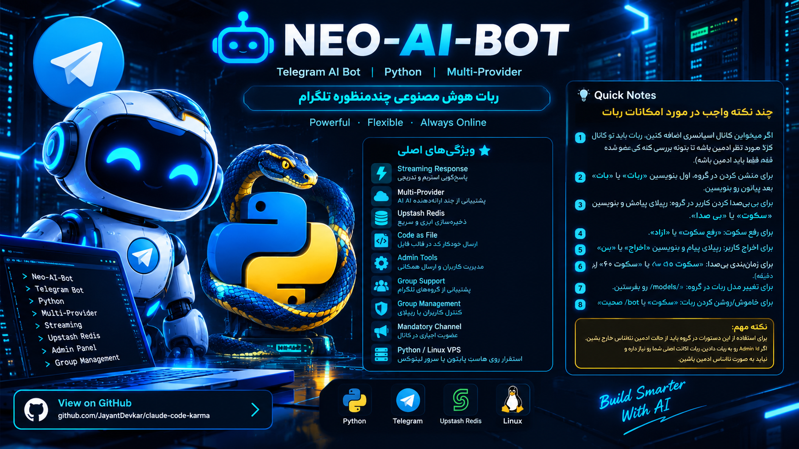

<div align="center">



# 🤖 Neo-AI-Bot

### ربات هوش مصنوعی چندمنظوره تلگرام

ربات تلگرامی هوش مصنوعی با پشتیبانی از ارائه‌دهندگان سازگار با API اوپن‌ای‌آی، پاسخ‌گویی استریم، ذخیره‌سازی ابری و ابزارهای مدیریتی.

**Developed with ❤️ by [NeoTenet](https://t.me/NeoTenet)**

[راهنمای فارسی](#-راهنمای-فارسی) · [English Guide](#-english-guide) · [استقرار](#-استقرار) · [پیکربندی](#-پیکربندی) · [راهنمای دستورات گروه](#-راهنمای-دستورات-و-نکات-مهم-ربات)

</div>

---

## 🌟 قابلیت‌ها در یک نگاه

- ⚡ **پاسخ‌گویی استریم (Streaming):** نمایش تدریجی پاسخ مدل به‌جای انتظار برای دریافت کل پاسخ.
- 🔌 **پشتیبانی از چند ارائه‌دهنده:** امکان اتصال به سرویس‌های هوش مصنوعی سازگار با API مورد استفاده پروژه.
- 🧠 **ذخیره‌سازی ابری با Upstash Redis:** نگهداری داده‌ها و تنظیمات موردنیاز بدون راه‌اندازی دیتابیس محلی.
- 📄 **ارسال خودکار کد در قالب فایل:** جداسازی قطعه‌کدها و ارسال آن‌ها به‌صورت فایل‌هایی مانند `.py`، `.js`، `.html`، `.cpp` و `.txt`.
- 🛠️ **ابزارهای مدیریتی:** مدیریت کاربران و ارسال پیام همگانی (Broadcast).
- 👥 **پشتیبانی از گروه‌های تلگرام:** امکان پاسخ‌گویی با منشن یا ریپلای و کنترل‌های مدیریتی مرتبط.
- 🛡️ **مدیریت گروه با ریپلای:** ادمین‌های گروه می‌توانند با ریپلای روی پیام کاربر، او را بی‌صدا یا آزاد کنند، از گروه اخراج و بن کنند یا پیامش را حذف کنند.
- 📣 **عضویت اجباری در کانال:** امکان تعیین کانال‌های موردنیاز برای استفاده از ربات.
- 🖥️ **قابلیت استقرار روی هاست پایتون یا Linux VPS:** اجرای پروژه روی محیط‌های میزبانی سازگار.

---

## 🌐 زبان‌ها / Languages

- [🇮🇷 راهنمای فارسی](#-راهنمای-فارسی)
- [🇬🇧 English Guide](#-english-guide)

---

# 🇮🇷 راهنمای فارسی

## 📋 معرفی

**Neo-AI-Bot** یک ربات هوش مصنوعی برای تلگرام است که با پایتون اجرا می‌شود و برای استقرار روی هاست‌های پایتونی، کانتینرها و سرورهای لینوکسی طراحی شده است. این پروژه از ذخیره‌سازی ابری Upstash Redis و قابلیت‌های استریم پاسخ استفاده می‌کند.

> **توجه:** امکانات نهایی ربات به پیاده‌سازی فعلی پروژه، سرویس‌دهنده هوش مصنوعی و محدودیت‌های هاست وابسته است.

## 🧰 پیش‌نیازها

- Python 3
- فایل‌های پروژه، از جمله `main.py` و `requirements.txt`
- ربات تلگرام و توکن دریافت‌شده از [@BotFather](https://t.me/BotFather)
- شناسه عددی تلگرام مدیر
- دیتابیس Upstash Redis با دسترسی REST
- کلید API سرویس هوش مصنوعی، در صورت نیاز به تنظیم در سورس پروژه

## ⚙️ پیکربندی

متغیرهای زیر را مطابق نام‌هایی که پروژه استفاده می‌کند تنظیم کنید:

| متغیر | توضیحات |
| --- | --- |
| `BOT_TOKEN` | توکن ربات تلگرام از `@BotFather` |
| `ADMIN_ID` | شناسه عددی مدیر ربات |
| `UPSTASH_URL` | نشانی REST دیتابیس Upstash Redis |
| `UPSTASH_TOKEN` | توکن دسترسی REST دیتابیس Upstash |

مقادیر را در بخش **Environment Variables** هاست وارد کنید، یا مطابق ساختار فعلی پروژه در فایل پیکربندی قرار دهید.

**نکته امنیتی:** توکن ربات، کلیدهای API و اطلاعات دیتابیس را در مخزن عمومی GitHub منتشر نکنید. اگر اطلاعات محرمانه ناخواسته منتشر شد، آن‌ها را از سرویس مربوطه باطل و جایگزین کنید.

## 🗄️ ساخت دیتابیس Upstash

1. وارد [Upstash](https://upstash.com) شوید و حساب کاربری ایجاد کنید.
2. گزینه ساخت دیتابیس (**Create Database**) را انتخاب کنید.
3. نام دیتابیس و منطقه جغرافیایی مناسب را انتخاب کنید.
4. صفحه دیتابیس را باز کرده و بخش **REST API** را پیدا کنید.
5. نشانی REST و توکن را در متغیرهای `UPSTASH_URL` و `UPSTASH_TOKEN` قرار دهید.

نام متغیرهای محیطی مورد استفاده در کد باید با نام‌هایی که در پروژه تعریف شده‌اند مطابقت داشته باشد.

## 🚀 اجرا روی هاست پایتونی

این روش برای هاست‌هایی مناسب است که از اجرای برنامه‌های پایتون پشتیبانی می‌کنند.

1. فایل‌های پروژه، از جمله `main.py` و `requirements.txt`، را در پوشه اصلی برنامه قرار دهید.
2. متغیرهای محیطی موردنیاز را در تنظیمات هاست وارد کنید.
3. وابستگی‌ها را با دستور زیر نصب کنید:

   ```bash
   pip install -r requirements.txt
   ```

4. دستور شروع برنامه را روی این مقدار قرار دهید:

   ```bash
   python main.py
   ```

5. برنامه را اجرا کنید و گزارش‌های اجرا را برای بررسی خطاها ببینید.

## 🖥️ استقرار روی Ubuntu / Debian VPS

### ۱. نصب پیش‌نیازها

```bash
sudo apt update
sudo apt install -y python3 python3-pip python3-venv git
```

### ۲. دریافت سورس و نصب وابستگی‌ها

```bash
git clone https://github.com/NeoTenet/Neo-Ai-Bot.git
cd Neo-Ai-Bot

python3 -m venv .venv
source .venv/bin/activate
pip install --upgrade pip
pip install -r requirements.txt
```

### ۳. آزمایش اجرای برنامه

پیش از ساخت سرویس دائمی، مطمئن شوید متغیرهای محیطی تنظیم شده‌اند و برنامه به‌صورت دستی اجرا می‌شود:

```bash
python main.py
```

پس از تأیید اجرای درست برنامه، آن را با `Ctrl+C` متوقف کنید تا برای اجرای سرویس آماده شوید.

### ۴. ساخت سرویس systemd

فایل سرویس را ایجاد کنید:

```bash
sudo nano /etc/systemd/system/neo-ai-bot.service
```

نمونه زیر را وارد کنید. مسیرها و نام کاربر را متناسب با محل واقعی نصب پروژه تغییر دهید:

```ini
[Unit]
Description=Neo AI Telegram Bot
After=network.target

[Service]
Type=simple
User=YOUR_LINUX_USER
WorkingDirectory=/path/to/Neo-Ai-Bot
EnvironmentFile=/etc/neo-ai-bot.env
ExecStart=/path/to/Neo-Ai-Bot/.venv/bin/python /path/to/Neo-Ai-Bot/main.py
Restart=always
RestartSec=5

[Install]
WantedBy=multi-user.target
```

فایل محیطی جداگانه ایجاد کنید تا اطلاعات محرمانه داخل فایل سرویس قرار نگیرند:

```bash
sudo nano /etc/neo-ai-bot.env
```

نمونه محتوا؛ مقادیر واقعی خودتان را وارد کنید:

```dotenv
BOT_TOKEN=YOUR_TELEGRAM_BOT_TOKEN
ADMIN_ID=YOUR_NUMERIC_TELEGRAM_ID
UPSTASH_URL=https://your-database.upstash.io
UPSTASH_TOKEN=YOUR_UPSTASH_REST_TOKEN
```

دسترسی فایل حاوی اطلاعات محرمانه را محدود کنید:

```bash
sudo chmod 600 /etc/neo-ai-bot.env
```

سپس سرویس را فعال و اجرا کنید:

```bash
sudo systemctl daemon-reload
sudo systemctl enable --now neo-ai-bot
sudo systemctl status neo-ai-bot
```

برای مشاهده گزارش‌های زنده:

```bash
sudo journalctl -u neo-ai-bot -f
```

> **مهم:** `YOUR_LINUX_USER` و مسیرهای `/path/to/Neo-Ai-Bot` مقادیر نمونه هستند و باید با مسیر و کاربر واقعی سرور جایگزین شوند. همچنین برنامه باید از متغیرهای محیطی پشتیبانی کند؛ در غیر این صورت، بخش پیکربندی سورس را مطابق ساختار پروژه تنظیم کنید.

## 🛡️ مدیریت کاربران گروه با ریپلای

ادمین‌های گروه می‌توانند با ریپلای روی پیام کاربر موردنظر و ارسال یکی از فرمان‌های زیر، اقدامات مدیریتی را انجام دهند:

| فرمان | نتیجه |
| --- | --- |
| `سکوت` یا `بی صدا` | بی‌صدا کردن دائمی کاربر؛ کاربر تا زمان رفع محدودیت نمی‌تواند در گروه پیام بفرستد. |
| `سکوت 10` یا `سکوت 60` | بی‌صدا کردن زمان‌دار بر حسب دقیقه؛ پس از پایان مدت تعیین‌شده، محدودیت به‌صورت خودکار برداشته می‌شود. |
| `رفع سکوت` یا `آزاد` | برداشتن محدودیت سکوت و اجازه ارسال پیام به کاربر. |
| `اخراج` یا `بن` | اخراج کاربر از گروه و مسدود کردن او از حضور مجدد در گروه. |
| `حذف` یا `پاک` | حذف پیامی که ادمین روی آن ریپلای کرده است. |

**نکته:** برای اجرای این فرمان‌ها، فرستنده باید ادمین گروه باشد و ربات نیز مجوزهای مدیریتی لازم، از جمله محدود کردن کاربران و حذف پیام‌ها را داشته باشد.

### تشخیص شکل‌های مختلف کلمهٔ ربات

برای فراخوانی هوش مصنوعی در گروه، ربات شکل‌های مختلف نوشتاری را نیز تشخیص می‌دهد؛ از جمله **ربات**، **روبات** (با واو)، **ربات:**، **ربات،** و **بات**. با استفاده از این شکل‌ها، پیام کاربر برای پاسخ‌گویی به هوش مصنوعی تحویل داده می‌شود.

**خروج از حالت سکوت آزمایشی:** اگر قبلاً برای آزمایش، دستور `/bot سکوت` را در گروه فرستاده‌اید، یک‌بار دستور `/bot صحبت` را در گروه ارسال کنید تا ربات از حالت سکوت خارج شود.

## 📌 راهنمای دستورات و نکات مهم ربات

### 1. عضویت اجباری در کانال اسپانسری
اگر می‌خواهید کانال اسپانسری به ربات اضافه کنید، باید ربات را در کانال موردنظر **ادمین** کنید تا بتواند بررسی کند کاربر عضو کانال هست یا نه. طبق توضیح پروژه، برای بررسی عضویت کافی است ربات ادمین کانال باشد؛ دسترسی‌های اضافی لازم نیست مگر آنکه تنظیمات کانال یا پیاده‌سازی ربات چیز دیگری بخواهد.

### 2. صدا زدن ربات در گروه
برای منشن یا صدا زدن ربات، ابتدای پیام خود بنویسید `ربات` یا `بات` و سپس درخواستتان را وارد کنید.

**نمونه:**
```text
ربات یک متن درباره هوش مصنوعی بنویس
بات این کد را توضیح بده
```

### 3. بی‌صدا کردن کاربر
روی پیام کاربر **Reply** کنید و یکی از عبارت‌های زیر را ارسال کنید:

- `سکوت`
- `بی صدا`

### 4. خارج کردن کاربر از حالت سکوت
روی پیام همان کاربر ریپلای کنید و یکی از این عبارت‌ها را بفرستید:

- `رفع سکوت`
- `آزاد`

### 5. اخراج یا بن کردن کاربر
روی پیام کاربر ریپلای کنید و بنویسید:

- `اخراج`
- `بن`

### 6. تعیین مدت سکوت
برای بی‌صدا کردن زمان‌دار، روی پیام کاربر ریپلای کنید و مدت را بر حسب دقیقه بنویسید؛ برای مثال:

```text
سکوت 10
سکوت 60
```

### 7. تغییر مدل هوش مصنوعی گروه
برای مشاهده مدل‌های در دسترس و انتخاب مدل موردنظر برای گروه، دستور زیر را ارسال کنید:

```text
/models
```

### 8. خاموش و روشن کردن پاسخ‌گویی ربات در گروه
برای متوقف کردن پاسخ‌گویی ربات در گروه، ارسال کنید:

```text
/bot سکوت
```

برای فعال کردن دوباره پاسخ‌گویی، ارسال کنید:

```text
/bot صحبت
```

### ⚠️ نکته مهم درباره ادمین ناشناس
برای اجرای دستورات مدیریتی، از حالت **ادمین ناشناس** خارج شوید. اگر شناسه عددی شما در تنظیمات ربات به‌عنوان `ADMIN_ID` ثبت شده است، ربات باید بتواند اکانت اصلی شما را تشخیص دهد؛ بنابراین هنگام اجرای این دستورات در گروه ناشناس نباشید.

> **یادآوری:** دستورات مدیریتی فقط در صورتی کار می‌کنند که فرستنده مجوز ادمین گروه را داشته باشد و ربات نیز دسترسی مدیریتی موردنیاز، مانند محدودکردن کاربران یا بن‌کردن آن‌ها، را دریافت کرده باشد.

---

## 🧯 عیب‌یابی سریع

- **ربات اجرا نمی‌شود:** گزارش سرویس را با `sudo journalctl -u neo-ai-bot -n 100 --no-pager` بررسی کنید.
- **خطای وابستگی‌ها:** فعال بودن محیط مجازی و نصب موفق `requirements.txt` را بررسی کنید.
- **خطای اتصال به Redis:** نشانی REST و توکن Upstash را بررسی کنید.
- **ربات به پیام‌ها پاسخ نمی‌دهد:** توکن ربات، تنظیمات سرویس هوش مصنوعی و لاگ‌های برنامه را بررسی کنید.
- **سرویس بعد از ویرایش اجرا نمی‌شود:** پس از تغییر فایل سرویس، `sudo systemctl daemon-reload` را اجرا و سرویس را دوباره راه‌اندازی کنید.

---

# 🇬🇧 English Guide

## Overview

**Neo-AI-Bot** is a Python-based Telegram AI bot designed for Python hosting platforms, containers, and Linux VPS environments. It uses Upstash Redis for cloud persistence and supports streaming-style responses.

### Key Features

- **Streaming responses** for progressive output.
- **Multi-provider support** for compatible AI APIs, subject to the project implementation.
- **Upstash Redis integration** for cloud-based persistence.
- **Automatic code-to-file delivery** for supported file types such as `.py`, `.js`, `.html`, `.cpp`, and `.txt`.
- **Admin tools** including broadcast messaging and user management.
- **Telegram group support** with mention/reply workflows.
- **Reply-based group moderation:** admins can mute users permanently or for a specified number of minutes, unmute them, ban them, or delete the replied-to message using Persian commands.
- **Mandatory channel membership** options.
- **Flexible deployment** on Python hosts or Linux VPS instances.

### Reply-Based Group Moderation

Group admins can reply to a user's message and send one of these Persian commands:

| Command | Action |
| --- | --- |
| `سکوت` or `بی صدا` | Mute the user until manually unmuted. |
| `سکوت 10` or `سکوت 60` | Mute the user for the specified number of minutes; the restriction is removed automatically when the time expires. |
| `رفع سکوت` or `آزاد` | Remove the user's mute restriction. |
| `اخراج` or `بن` | Remove and ban the user from the group. |
| `حذف` or `پاک` | Delete the message being replied to. |

**Note:** The sender must be a group admin, and the bot must have the required admin permissions, including restricting members and deleting messages.

### Recognizing Different Forms of “Bot”

When addressing the AI in a group, the bot also recognizes common variations, including **ربات**, **روبات**, **ربات:**, **ربات،**, and **بات**. Messages using these forms are forwarded to the AI for a response.

**Exit test silence mode:** If you previously sent `/bot سکوت` while testing, send `/bot صحبت` once in the group to bring the bot out of silence mode.

### Group Commands and Important Notes

1. **Sponsored channel membership:** Add the bot as an administrator in the required channel so it can check whether a user has joined.
2. **Call the bot:** Start your group message with `ربات` or `بات`, followed by your request.
3. **Mute a user:** Reply to the user's message with `سکوت` or `بی صدا`.
4. **Unmute a user:** Reply with `رفع سکوت` or `آزاد`.
5. **Kick/ban a user:** Reply with `اخراج` or `بن`.
6. **Timed mute:** Reply with `سکوت 10` or `سکوت 60`; the number represents minutes.
7. **Choose a group model:** Send `/models` to view the available models.
8. **Pause/resume bot replies:** Send `/bot سکوت` to pause replies and `/bot صحبت` to resume.
9. **Anonymous admin mode:** Leave anonymous-admin mode when issuing admin commands so the bot can identify the account configured as `ADMIN_ID`.

The sender must be a group administrator, and the bot must have the required Telegram admin permissions for moderation actions.

---

## Requirements

- Python 3
- Project files, including `main.py` and `requirements.txt`
- Telegram bot token from [@BotFather](https://t.me/BotFather)
- Numeric Telegram admin ID
- Upstash Redis REST URL and token
- AI provider credentials, if required by the project configuration

## Environment Variables

| Variable | Description |
| --- | --- |
| `BOT_TOKEN` | Telegram bot token |
| `ADMIN_ID` | Numeric Telegram admin ID |
| `UPSTASH_URL` | Upstash Redis REST endpoint |
| `UPSTASH_TOKEN` | Upstash Redis REST access token |

Keep credentials in your hosting provider's environment settings or a protected environment file. **Never commit secrets to a public repository.**

## Deploy on a Python Host

1. Upload `main.py`, `requirements.txt`, and the required project files.
2. Configure the required environment variables.
3. Install dependencies:

   ```bash
   pip install -r requirements.txt
   ```

4. Set the startup command:

   ```bash
   python main.py
   ```

5. Start the application and inspect the host logs if it fails.

## Deploy on Ubuntu / Debian

Install the required packages:

```bash
sudo apt update
sudo apt install -y python3 python3-pip python3-venv git
```

Clone the repository and install dependencies in a virtual environment:

```bash
git clone https://github.com/NeoTenet/Neo-Ai-Bot.git
cd Neo-Ai-Bot

python3 -m venv .venv
source .venv/bin/activate
pip install --upgrade pip
pip install -r requirements.txt
```

Test the application before configuring the service:

```bash
python main.py
```

For persistent execution, create `/etc/systemd/system/neo-ai-bot.service` and adapt the paths and Linux user to your server:

```ini
[Unit]
Description=Neo AI Telegram Bot
After=network.target

[Service]
Type=simple
User=YOUR_LINUX_USER
WorkingDirectory=/path/to/Neo-Ai-Bot
EnvironmentFile=/etc/neo-ai-bot.env
ExecStart=/path/to/Neo-Ai-Bot/.venv/bin/python /path/to/Neo-Ai-Bot/main.py
Restart=always
RestartSec=5

[Install]
WantedBy=multi-user.target
```

Create `/etc/neo-ai-bot.env` with your actual values, restrict its permissions, then enable the service:

```bash
sudo chmod 600 /etc/neo-ai-bot.env
sudo systemctl daemon-reload
sudo systemctl enable --now neo-ai-bot
sudo systemctl status neo-ai-bot
sudo journalctl -u neo-ai-bot -f
```

Replace all example paths and placeholder values before starting the service. The application must read the configured environment variables for this setup to work as written.

---

## 👨‍💻 Creator & Support

- **Creator:** [NeoTenet](https://t.me/NeoTenet)
- **Repository:** [NeoTenet/Neo-Ai-Bot](https://github.com/NeoTenet/Neo-Ai-Bot)
- **License:** MIT *(as stated by the project; add the `LICENSE` file to the repository if it is not already present)*

---

<div align="center">

Made with ❤️ by **[NeoTenet](https://t.me/NeoTenet)**

</div>
