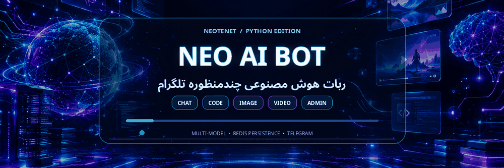
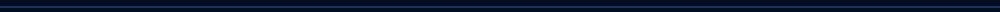
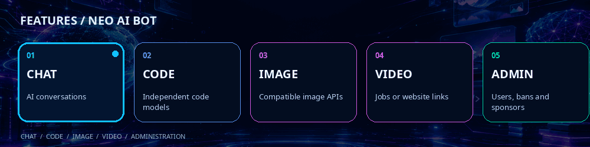

<div align="center">
  

  <h1>🤖 Neo-AI-Bot</h1>
  <h3>ربات هوش مصنوعی چندمنظوره تلگرام</h3>
  <p>چت هوشمند، برنامه‌نویسی، ساخت تصویر و ویدیو، تاریخچه گفتگو و پنل مدیریت</p>

  <a href="https://t.me/NeoTenet"></a>
  
  
  

  <br><br>
  <a href="#-راهنمای-فارسی">راهنمای فارسی</a> · <a href="README_EN.md">English guide</a> · <a href="#-نصب-و-راهاندازی">نصب</a> · <a href="#-راهنمای-ادمین">راهنمای ادمین</a> · <a href="#-فرمانهای-گروه">فرمان‌های گروه</a>
</div>



<div dir="rtl">

## 🌌 معرفی پروژه

**Neo-AI-Bot** یک ربات تلگرام مبتنی بر پایتون است که چند حالت مستقل برای گفتگو، برنامه‌نویسی، تولید تصویر و تولید ویدیو دارد. تنظیمات مدل‌ها، کاربران، تاریخچه و کانال‌های اسپانسر با استفاده از **Upstash Redis REST** نگهداری می‌شوند.

## ✨ امکانات اصلی

<div align="center">
  
</div>

🔴چند هاست رایگان پایتون برای ساخت ربات های تلگرام 

 🔘botkeep.cloud
 🔘wispbyte.com

  🔘 ویدیو ساخت و راه اندازی ربات روی هاست رایگان 

    🌐 https://t.me/neotenet/552
| بخش | امکانات |
|:---|:---|
| 💬 گفت‌وگو | انتخاب مدل چت از پنل و نمایش نام مدل انتخاب‌شده در بنر خوش‌آمدگویی |
| 💻 برنامه‌نویسی | فهرست مدل‌های کدنویسی مجزا؛ ارسال خودکار کدهای طولانی به‌صورت فایل در قالب‌های پشتیبانی‌شده |
| 🎨 تصویر | مدیریت مدل‌های تصویر، پشتیبانی از APIهای سازگار و پیگیری jobهای غیرهم‌زمان در سرویس‌های پشتیبانی‌شده |
| 🎬 ویدیو | مدیریت مدل ویدیو، بررسی وضعیت job و ارسال لینک/فایل خروجی در صورت سازگاری API؛ امکان نمایش لینک سایت وقتی فقط وب‌سایت تنظیم شده باشد |
| 📜 تاریخچه | ذخیره خودکار گفتگوها، عنوان‌گذاری بر اساس پیام آغازین، ساعت ایران و نگهداری حداکثر ۷ گفتگو |
| 🧭 منوی کاربر | دکمه‌های شیشه‌ای و صفحه‌کلید ثابت برای منوی اصلی و تاریخچه؛ منوی مدیریت فقط برای مدیر اصلی |
| 🛠 مدیریت مدل‌ها | افزودن، انتخاب، ویرایش و حذف مدل‌های چت، برنامه‌نویسی، تصویر و ویدیو؛ تنظیم API Key، Base URL و Model Name در مدل‌های مربوط |
| 👥 مدیریت کاربران | جست‌وجو با شناسه عددی، مشاهده مشخصات، بن/آنبن، مدیریت رکورد کاربر، پیام مستقیم و افزودن دستی |
| 📊 آمار | نمایش کاربران ثبت‌نامی، فعال، غیرفعال، بن‌شده و ارسال‌های ناموفق قابل شناسایی |
| 📢 اسپانسر | فهرست کانال‌ها با قابلیت افزودن، ویرایش و حذف؛ بررسی عضویت اجباری |
| 🛡️ مدیریت گروه | سکوت ربات، قفل گروه و اقدامات مدیریتی روی پیام ریپلای‌شده، در صورت داشتن مجوزهای لازم |
| 🌐 زبان | رابط کاربری فارسی و انگلیسی |
| 💾 ذخیره‌سازی | ذخیره اطلاعات و تنظیمات در Upstash Redis با REST API |

### نکات مهم دربارهٔ قابلیت‌های هوش مصنوعی

- **ساخت تصویر و ویدیو:** کارکرد مستقیم در تلگرام به API واقعی و قالب درخواست/پاسخ همان سرویس بستگی دارد. آدرس صفحهٔ معمولی سایت به‌تنهایی API نیست؛ در حالت سایت‌محور، ربات لینک سایت را باز می‌کند و تولید داخل تلگرام انجام نمی‌شود.
- **جست‌وجوی وب:** موتور جست‌وجوی مستقل Google/Bing/Brave/SearXNG در نسخهٔ فعلی وجود ندارد. وب‌گردی فقط وقتی انجام می‌شود که API مدل انتخاب‌شده ابزار جست‌وجوی بومی سازگار داشته باشد.
- **مدل‌ها:** نام مدل، endpoint و شیوهٔ احراز هویت را عین مستندات ارائه‌دهنده وارد کنید. سازگاری با API اوپن‌ای‌آی به معنی سازگاری خودکار با همهٔ APIهای تصویر و ویدیو نیست.
- **کاربران غیرقابل‌دسترسی:** خطای ارسال پیام لزوماً ثابت نمی‌کند کاربر ربات را بلاک کرده است؛ تلگرام فهرست قطعیِ «افراد لفت‌داده» در اختیار ربات نمی‌گذارد.


## 🧰 پیش‌نیازها

- Python **3.10 یا بالاتر** پیشنهاد می‌شود.
- یک ربات تلگرام و توکن آن از [@BotFather](https://t.me/BotFather).
- شناسهٔ عددی حساب مدیر اصلی (`ADMIN_ID`).
- یک دیتابیس [Upstash Redis](https://upstash.com/) با REST URL و REST Token.
- کلید API یک سرویس هوش مصنوعی، برای هر مدلی که به کلید نیاز دارد.
- هاستی که اجرای پیوستهٔ پایتون و درخواست‌های خروجی HTTPS را پشتیبانی کند.

## 🚀 نصب و راه‌اندازی

### ۱. دریافت فایل‌ها

ZIP را استخراج کنید؛ ساختار اصلی پروژه چنین است:

```text
Neo-AI-Bot-Updated/
├── main.py
├── Bot_Ai_Beta_5_Model_Banner.py
├── requirements.txt
├── .env.example
├── Dockerfile
├── README.md
├── README_EN.md
├── docs/
└── assets/
    ├── banner.gif
    ├── features.gif
    └── divider.gif
```

`main.py` و `Bot_Ai_Beta_5_Model_Banner.py` هر دو یک نسخه از سورس هستند؛ برای اجرا فقط یکی را انتخاب کنید. روش پیش‌فرض این راهنما `main.py` است.

### ۲. ساخت دیتابیس Upstash

1. در [Upstash](https://upstash.com/) یک حساب ایجاد کنید.
2. یک دیتابیس Redis بسازید.
3. از صفحهٔ دیتابیس، مقادیر **REST URL** و **REST Token** را بردارید.
4. آن‌ها را در متغیرهای محیطی هاست وارد کنید؛ آدرس صفحهٔ داشبورد، جای REST URL نیست.

### ۳. تنظیم متغیرهای محیطی

در قسمت **Environment Variables / Secrets** هاست این چهار متغیر را تنظیم کنید:

| متغیر | مقدار |
|:---|:---|
| `BOT_TOKEN` | توکن دریافت‌شده از BotFather |
| `ADMIN_ID` | شناسهٔ عددی مدیر اصلی، بدون `@` |
| `UPSTASH_URL` | نشانی REST دیتابیس Upstash |
| `UPSTASH_TOKEN` | توکن REST دیتابیس Upstash |

فایل `.env.example` فقط نمونهٔ راهنماست؛ سورس فعلی مستقیماً از متغیرهای محیطی سیستم می‌خواند و فایل `.env` را به‌صورت خودکار بارگذاری نمی‌کند. مقادیر واقعی را در مخزن عمومی قرار ندهید.

### ۴. نصب وابستگی‌ها و اجرا

Linux / VPS / هاست پایتون:

```bash
python -m pip install -r requirements.txt
python main.py
```

اگر از نام اصلی اسکریپت استفاده می‌کنید:

```bash
python Bot_Ai_Beta_5_Model_Banner.py
```

### ۵. اجرا با Docker

بعد از قرار دادن متغیرهای محیطی در محیط اجرا:

```bash
docker build -t neo-ai-bot .
docker run --name neo-ai-bot --restart unless-stopped \
  -e BOT_TOKEN="$BOT_TOKEN" \
  -e ADMIN_ID="$ADMIN_ID" \
  -e UPSTASH_URL="$UPSTASH_URL" \
  -e UPSTASH_TOKEN="$UPSTASH_TOKEN" \
  neo-ai-bot
```

> اگر هاست شما بخش Start Command دارد، `python main.py` را انتخاب کنید. توکن‌ها و کلیدها را داخل Dockerfile یا کد hard-code نکنید.


## ⚙️ تنظیم اولیه از تلگرام

### مدیر اصلی

1. متغیرهای محیطی را تنظیم و برنامه را اجرا کنید.
2. در گفت‌وگوی خصوصی با ربات `/start` بفرستید.
3. دکمهٔ **پنل مدیریت ادمین** را باز کنید.
4. مدل‌ها را از پنل وارد کنید؛ تنظیمات در Redis ذخیره می‌شوند.

### افزودن مدل چت یا برنامه‌نویسی

اطلاعات را دقیقاً مطابق مستندات API ارائه‌دهنده وارد کنید:

1. **نام نمایشی**: برچسبی برای نمایش به کاربر.
2. **Base URL**: endpoint API، نه آدرس معمولی صفحهٔ وب.
3. **API Key**: کلید خصوصی سرویس؛ اگر API کلید نمی‌خواهد، از مقدار خالیِ موردپذیرش پنل استفاده کنید.
4. **Model Name**: شناسهٔ واقعی مدل.
5. **Vision**: مشخص کنید مدل ورودی تصویر را پشتیبانی می‌کند یا خیر، اگر این گزینه در فرم مدل نمایش داده می‌شود.

مدل‌های برنامه‌نویسی از مدل‌های چت مستقل‌اند. اگر هنوز مدل برنامه‌نویسی جداگانه‌ای تعریف نشده باشد، کد از مدل چت به‌عنوان fallback استفاده می‌کند.

### افزودن مدل تصویر

در پنل ادمین، **افزودن مدل عکس** را انتخاب کرده و نام، endpoint API، کلید، شناسهٔ مدل و در صورت وجود آدرس سایت را وارد کنید. آدرس سایت فقط لینک مرورگر است و جای endpoint API را نمی‌گیرد.

### افزودن مدل ویدیو

در پنل ادمین، **افزودن مدل ویدیو** را انتخاب کنید و فیلدهای زیر را مطابق API سرویس پر کنید:

- **Base URL / Endpoint:** آدرس واقعی API ساخت ویدیو.
- **API Key:** کلید سرویس، اگر لازم است.
- **Model Name:** شناسهٔ دقیق مدل.
- **Website URL:** لینک سایت برای حالت سایت‌محور.
- **Status URL Template:** قالب آدرس پیگیری وضعیت job، اگر سرویس job ID می‌دهد؛ فقط مطابق مستندات سرویس از `{id}` استفاده کنید.

اگر فقط سایت دارید، می‌توانید endpoint و اطلاعات API را خالی بگذارید و فقط Website URL را تنظیم کنید؛ در این حالت، کاربر به سایت هدایت می‌شود و ساخت مستقیم داخل تلگرام فعال نیست.

### تاریخچهٔ گفتگو

چت جدید به‌صورت خودکار ثبت می‌شود. فهرست تاریخچه حداکثر ۷ گفتگو را نگه می‌دارد؛ عنوان از پیام آغازین گرفته می‌شود و زمان برای کاربر فارسی به وقت ایران نمایش داده می‌شود. علامت سبز نشان‌دهندهٔ گفت‌وگوی فعال است. حذف یک گفتگو از فهرست، طبق رفتار نسخه، رکورد گفت‌وگوی انتخاب‌شده را پاک می‌کند.


## 🧭 فرمان‌های گروه

### صدا زدن ربات

در گروه، درخواست خود را با یکی از شکل‌های زیر شروع کنید:

- `ربات درباره لینوکس توضیح بده`
- `روبات: این کد پایتون را بررسی کن`
- `بات یک مثال از API بنویس`
- `نئو سلام`
- `neo explain DNS`
- `tenet explain this error`

برای پاسخ به پیام خاص، می‌توانید به پیام ریپلای کنید و ربات را صدا بزنید. پاسخ‌دهی تابع تنظیمات گروه، privacy mode تلگرام و دسترسی ربات به پیام‌هاست.

### مدیریت گروه با Reply

برای فرمان‌های مربوط به کاربر، ابتدا به **پیام همان کاربر Reply** کنید:

| عبارت | کاربرد |
|:---|:---|
| `سکوت` یا `بی صدا` | محدودکردن پیام‌دادن کاربر تا رفع محدودیت |
| `سکوت 10` | سکوت به مدت ۱۰ دقیقه |
| `رفع سکوت` یا `آزاد` | برداشتن سکوت |
| `اخراج`، `بن` یا `/ban` | مسدودکردن کاربر از گروه |
| `حذف` یا `پاک` | حذف پیام هدف، در صورت داشتن مجوز |

### کنترل ربات و قفل گروه

| فرمان | کاربرد |
|:---|:---|
| `/bot سکوت` یا `/mute_bot` | متوقف‌کردن پاسخ‌های ربات در گروه |
| `/bot صحبت` یا `/unmute_bot` | فعال‌کردن دوباره پاسخ‌های ربات |
| `/lock` یا `/close` | قفل‌کردن ارسال پیام در گروه، اگر دسترسی کافی وجود داشته باشد |
| `/unlock` یا `/open` | بازکردن گروه |
| `/models` | مشاهده/انتخاب مدل‌های مجاز در گروه، طبق کنترل دسترسی نسخه |

فرمان‌های مدیریتی به ادمین‌بودن فرستنده و مجوزهای کافی ربات نیاز دارند. ادمین ناشناس گروه ممکن است با `ADMIN_ID` تطبیق داده نشود.


## 🛠 پنل مدیریت ادمین

در پنل، گزینه‌های زیر در دسترس هستند (دسترسی واقعی به تنظیمات و وضعیت Redis وابسته است):

- روشن/خاموش‌کردن ربات و مشاهدهٔ آمار.
- مدیریت کاربران، جست‌وجو با شناسهٔ عددی، مشاهدهٔ مشخصات، بن/آنبن، حذف از فهرست و پیام مستقیم.
- فهرست کاربران غیرفعال (بازهٔ پیش‌فرض ۳۰ روز)، بن‌شده و ارسال‌های ناموفق قابل‌شناسایی.
- ارسال پیام همگانی.
- خروجی پشتیبان و بازگردانی تاریخچهٔ گفتگوها.
- پاکسازی کش موقت.
- افزودن، ویرایش، انتخاب و حذف مدل‌های چت، برنامه‌نویسی، عکس و ویدیو.
- افزودن، ویرایش و حذف کانال‌های اسپانسر.
- راهنمای تنظیم مدل‌ها داخل خود ربات.


## 🔒 امنیت و حریم خصوصی

- `BOT_TOKEN`، توکن Redis و API Keyها را در GitHub عمومی منتشر نکنید.
- کلیدهای API را فقط در پنل مدیریتی امن یا Secrets هاست وارد کنید.
- مدیر اصلی با `ADMIN_ID` تعیین می‌شود؛ شناسهٔ عددی را استفاده کنید، نه نام کاربری یا آیدی گروه.
- قابلیت‌های تصویر و ویدیو بسته به شرایط سرویس‌دهنده، دادهٔ ارسالی و سیاست‌های آن سرویس عمل می‌کنند.
- تاریخچه و تنظیمات در دیتابیس Upstash نگهداری می‌شوند؛ قبل از استفادهٔ عمومی، سیاست نگهداری داده‌ها را با کاربران خود روشن کنید.

## 🧯 عیب‌یابی سریع

| مشکل | بررسی پیشنهادی |
|:---|:---|
| ربات شروع نمی‌شود | وجود هر چهار متغیر محیطی و صحت `BOT_TOKEN` را بررسی کنید. |
| خطای Redis | REST URL و REST Token و دسترسی خروجی HTTPS هاست را بررسی کنید. |
| مدل پاسخ نمی‌دهد | Base URL، API Key، Model Name، اعتبار حساب ارائه‌دهنده و قالب API را بررسی کنید. |
| تصویر یا ویدیو ساخته نمی‌شود | مطمئن شوید endpoint و روش احراز هویت با API واقعی سرویس مطابقت دارد؛ لینک سایت کافی نیست. |
| فرمان‌های گروهی کار نمی‌کنند | مجوزهای مدیریتی ربات، ادمین‌بودن فرستنده و Reply به پیام هدف را بررسی کنید. |
| بنر نام مدل را تازه نمی‌کند | دوباره `/start` را در گفت‌وگوی خصوصی بفرستید و خطاهای edit-message را از لاگ بررسی کنید. |

## 🤝 مشارکت و پشتیبانی

- **مخزن پروژه:** [NeoTenet/Neo-Ai-Bot-Python](https://github.com/NeoTenet/Neo-Ai-Bot-Python)
- **کانال تلگرام:** [@NeoTenet](https://t.me/NeoTenet)
- **گزارش مشکل:** [GitHub Issues](https://github.com/NeoTenet/Neo-Ai-Bot-Python/issues)

</div>


<div align="center">
  <p><b>Built for Telegram · Powered by Python · Styled with neon motion</b></p>
  
  <sub>Made with ❤️ by <a href="https://t.me/NeoTenet">NeoTenet</a></sub>
</div>
