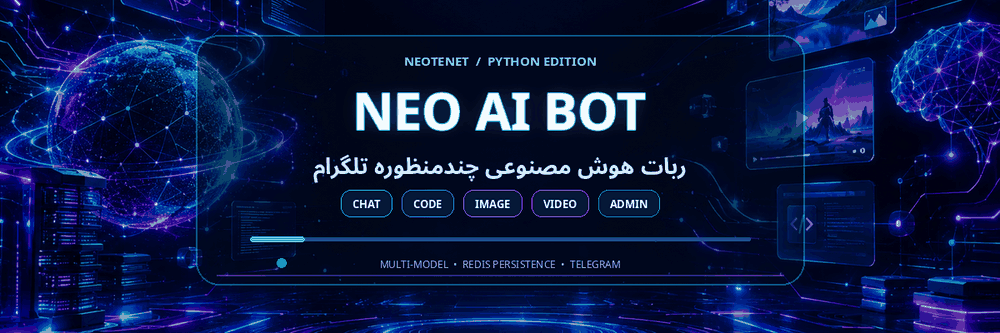
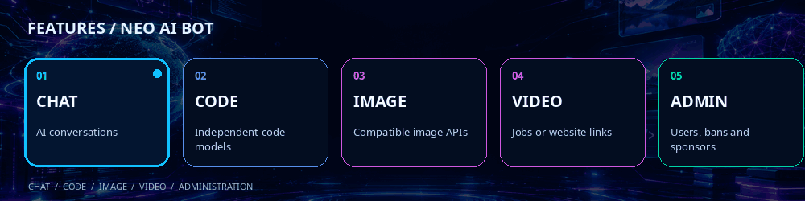

<div align="center">
  
  <h1>Neo-AI-Bot</h1>
  <h3>Multi-mode AI Telegram Bot</h3>
  <p>Chat · Coding · Image · Video · Admin CRM</p>
  <a href="https://t.me/NeoTenet"></a>
  
  
  <br><br>
  <a href="README.md">🇮🇷 راهنمای فارسی</a> · <a href="https://github.com/NeoTenet/Neo-Ai-Bot-Python/issues">Report an issue</a>
</div>


## Overview

Neo-AI-Bot is a Python Telegram bot with separate modes for chat, coding, image generation, and video generation. It uses Upstash Redis REST for persisted settings, user records, and chat-history metadata.

## Main features



- Four user-facing modes: chat, coding, image, and video.
- Separate model registries for chat, programming, image, and video.
- Model selection updates the welcome banner with the active mode and model name.
- Long code blocks can be delivered as downloadable files for supported languages.
- Image/video API flows can poll asynchronous jobs when supported by the provider's API format.
- Video model entries can include a website URL; site-only mode opens the website and does not create media directly in Telegram.
- Up to seven saved conversations, titles derived from the first message, and Iran-local display time for Persian users.
- Admin panel for users, broadcasts, chat backup/restore, model management, sponsor channels, and statistics.
- Group triggers, reply-based moderation, bot mute/unmute, and group lock/unlock.
- Persian and English UI.

### Web search note

This release does **not** include a standalone Google/Bing/Brave/SearXNG search menu. Web browsing is attempted only through supported native search tools provided by a compatible selected AI API.

## Requirements

- Python 3.10+ recommended
- Telegram bot token from [@BotFather](https://t.me/BotFather)
- Numeric admin Telegram user ID
- Upstash Redis REST URL and token
- Provider API credentials for models that require them

## Setup

1. Create an Upstash Redis database and copy its REST URL and REST token.
2. Configure these environment variables in your hosting dashboard:

   | Variable | Description |
   |---|---|
   | `BOT_TOKEN` | Telegram bot token |
   | `ADMIN_ID` | Numeric Telegram user ID of the main admin |
   | `UPSTASH_URL` | Upstash Redis REST endpoint |
   | `UPSTASH_TOKEN` | Upstash Redis REST token |

3. Install dependencies and run:

   ```bash
   python -m pip install -r requirements.txt
   python main.py
   ```

`main.py` and `Bot_Ai_Beta_5_Model_Banner.py` contain the same source. The `.env.example` file is a reference only: the script reads operating-system environment variables and does not load `.env` automatically.

## Configure models

Open `/start` in a private chat and use the Admin Panel. Enter the endpoint, API key, and model ID exactly as specified by each provider. For image/video models, a normal website URL is not a substitute for a provider API. If only a website URL is configured for video, the bot opens that site rather than generating the video inside Telegram.

## 🎬 Video Generation Guide

Video generation uses its own model registry (`VIDEO_MODELS`), separate from chat, coding, and image models. Direct generation and delivery inside Telegram are handled in a **private chat**.

### Generate a video as a user

1. Open the bot in a private chat and send `/start`.
2. Choose **🎬 Generate Video** from the main menu. If multiple video models are available, select the model you want from the model-selection area. VIP models remain subject to the user's access permissions.
3. When video mode asks for a prompt, send a description of the scene and the result you want to create.
4. As an alternative, send the `/video` command followed by the prompt:

   ```text
   /video A cinematic shot of a futuristic city at sunset
   ```

5. The bot submits the request to the selected provider API, tracks the job when the provider uses asynchronous generation, and sends the resulting video in Telegram when a downloadable result is available.

A **Cancel Request** button is available while generation is running. The status message can show queue, preparation, generation, rendering, and finalization stages. A provider-reported percentage is shown only when the provider actually returns progress data. A download percentage can also be shown when the response includes a file size.

### Add and configure a video model (admin)

In the private chat, open `/start` → **Admin Panel** → **Add Video Model**, then complete the setup wizard:

| Field | Description |
|:---|:---|
| Display name | Name shown in the video-model selector. |
| Base URL | The provider's actual API endpoint; a normal website homepage is not an API endpoint. |
| API Key | Provider credential. Agnes requires an API key; when a provider does not require one, follow the wizard and send `.`. |
| Model Name | The exact model identifier expected by the provider. |
| API type | Automatic detection or the adapter that matches the provider's API. |
| Input parameters | A valid JSON object for provider-specific settings such as duration, aspect ratio, or resolution. |
| Website URL | Optional website link for a site-only workflow. |

The source includes ready adapters for **Agnes, Runway, Replicate, fal.ai, Kling, Luma, unofficial OpenAI Videos-compatible gateways, generic JSON APIs, and custom REST profiles**. Automatic detection is available for recognized provider domains. For other services, choose the correct API type or configure Custom REST. An adapter does not guarantee that an account has access to a provider or model.

### Duration and input settings

- The default duration can be edited from the video-model card. An admin can set one default duration or register a comma-separated list of supported durations; send `auto` to return to automatic detection. In the current user flow, requests use the model's configured `seconds` value; there is no separate per-request duration picker for users.
- Durations recognized by the current adapters: **Agnes Video 2.5: 4–12 seconds; Kling: 3–15 seconds; Luma: 5 or 10 seconds**. For other providers, configure only durations documented by that provider.
- Aspect ratio, resolution, and options such as audio or multi-shot are read from model settings and `inputDefaults` when supported by the selected adapter. These parameters are provider-specific and are not interchangeable across APIs.
- Use **Model Input Parameters (JSON)** to add or edit provider-specific defaults. The value must be a valid JSON object; send `.` to clear saved defaults.

### Custom REST for other video APIs

When a provider is not covered by a ready adapter, select **Custom REST** and describe its request format using the provider's documentation. Example:

```json
{
  "createPath": "/v1/videos/generations",
  "auth": "bearer",
  "payload": {
    "model": "{model}",
    "prompt": "{prompt}"
  },
  "statusUrlTemplate": "{base_url}/v1/jobs/{id}"
}
```

Available template variables include `{prompt}`, `{model}`, `{api_key}`, `{base_url}`, `{id}`, and `{job_id}`. Advanced profiles can also define `headers`, `bodyType` (`json` or `form`), `responseUrlTemplate`, `contentUrlTemplate`, and `pollInterval`. The `auth` option supports `bearer`, `key`, `raw`, or `none`. Custom `jobIdField`, `statusField`, and `videoUrlField` values must match the provider's actual response structure. APIs requiring OAuth, HMAC signing, or complex multipart flows may need a dedicated adapter.

If the API returns a direct video URL immediately, a `statusUrlTemplate` is usually unnecessary. If the provider creates an asynchronous job, configure the job ID or status URL and the result-retrieval route according to its API response. An incorrect polling template can prevent the bot from finding the job status or final video.

### Queue, cancellation, downloads, and limits

- Video processing has a dedicated worker and queue. Worker count, queue capacity, and provider concurrency can be adjusted. Source defaults are `VIDEO_JOB_WORKERS=1`, `VIDEO_JOB_QUEUE_LIMIT=1000`, and `VIDEO_PROVIDER_CONCURRENCY=1`.
- API waiting time is controlled by `API_TIMEOUT_SECONDS`; the source default is 3,600 seconds. Actual generation time depends on the provider and its queue.
- Explicit rate-limit or queue-full rejections can be retried according to provider guidance and `Retry-After`. Ambiguous network failures during job creation are not blindly retried, helping avoid duplicate jobs or charges.
- The current source uses a **49 MB** video-upload ceiling. When a file is too large or Telegram upload fails, the bot provides the direct result link when the provider returned a valid URL.
- When only `Website URL` is configured and `Base URL` is empty, the bot opens the provider website. Video generation does not happen inside Telegram in this site-only mode.
- If no video model is configured, or the endpoint, credentials, job ID, polling route, or output URL is invalid or missing, the bot reports an error. Check the Base URL, Model Name, API Key, API type, and provider response format against the provider's documentation.

## Group commands

- Call the bot with a supported prefix such as `ربات ...`, `بات ...`, `نئو ...`, `neo ...`, or `tenet ...`.
- Additional supported forms include `روبات ...`, `نعو ...`, `تننت ...`, and `neo-...`; direct `@username` mentions are also supported.
- Reply to a user's message with `سکوت`, `سکوت 10`, `رفع سکوت`, `اخراج`, `بن`, `حذف`, or `پاک`.
- `/bot سکوت` and `/bot صحبت` pause/resume bot responses in the group.
- `/lock` / `/close` lock the group; `/unlock` / `/open` unlock it, if the bot has permissions.
- `/models` opens model selection subject to the version's access checks.

Moderation commands require suitable group-admin status and Telegram permissions for the bot.

## 🆕 Menu and Conversation Experience Improvements

### Glass Menu and Persistent Reply Keyboard

- The main options available in the glass menu are also accessible through the persistent keyboard at the bottom of the chat. The displayed options follow the user's or administrator's access level.
- A dedicated **Glass Menu** button opens the glass menu. The bottom reply keyboard and the glass menu remain separate ways to navigate the bot.
- The **Main Menu** action in the bottom keyboard has been adjusted so users can return from a submenu without getting stuck.
- Sending `/start` again displays the menu and keyboard again, including after a Telegram conversation has been cleared and the user starts the bot again.

### AI Responses and Request Cancellation

- While an AI request is being processed, a **Cancel Request** button is shown so the running request can be stopped.
- After the final AI response is ready, it is sent without an administrator or user control keyboard attached beneath it.
- The glass menu and bottom keyboard remain independently accessible; navigation controls are not mixed into the AI response message.

### Configurable System Prompts

Administrators can configure model behavior instructions from the chat-model information/edit section:

- **`CHAT`**: a shared instruction set for chat-mode models.
- **`CODE`**: a shared instruction set for coding-mode models and programming responses.
- System Prompt text is stored in **Upstash Redis** and persists across bot restarts.
- The maximum System Prompt length is **8,000 characters**.
- Send a single period (`.`) in the corresponding input to clear the current prompt.
- A System Prompt guides the model's tone, style, and response behavior. It does not independently add tools, internet access, or new technical capabilities.

### Persian Context-Aware Reactions

Message reactions take more account of the meaning and tone of Persian sentences. For example, an angry statement should not receive an approving reaction merely because it contains a seemingly positive word, and sarcastic or humorous wording should be distinguished from a genuinely serious or positive statement.

Examples that should be interpreted by their actual tone:

- `از دستش خیلی عصبانی‌ام` expresses anger and should not incorrectly receive an approving reaction such as `👍`.
- `چه دلقک‌بازی‌ای 😂` is humorous/sarcastic and should be distinguished from serious approval.
- `این حرکت خیلی عقده‌ای بود` is critical and negative, and should not incorrectly receive an approving reaction such as `👍`.

### Free and VIP Model Access

- Any chat, coding, image, or video model can be marked **Free** or **VIP** from that model's admin edit card.
- Administrators can configure the support contact and grant or revoke access to an individual VIP model for a specific user.
- The model catalog displays each model's Free/VIP status. Users who select a locked VIP model receive a support/contact route and information about requesting access.
- Access requests are sent to the administrator, who can approve or reject them.

### Coding Model Fallback and Health Status

- Coding models have a registry separate from chat models. When `CODE_MODELS` is empty, versions with the chat-model fallback enabled use the selected chat model for coding requests.
- When `CODE_MODELS` is empty but `AI_MODELS` contains at least one chat model, coding mode falls back to the selected chat model and the health check reports that fallback as active; this is not a Telegram or Redis connectivity failure. If no chat model is configured either, add a chat model before expecting AI responses.
- Health checks should report model-registry configuration separately from connectivity checks such as Telegram API status and Upstash Redis `PING/PONG`, where that check is available.

### Group Call Aliases

The bot can be called in groups using `ربات`, `روبات`, `بات`, `نئو`, `neo`, `neo-`, `نعو`, `تننت`, or `tenet`. Direct `@username` mentions are also supported. Replies still depend on the group's settings, Telegram Privacy Mode, and the bot's access to messages.

### Bot Health Report

The **Bot Health / Load Test** in the admin panel performs bounded, non-destructive checks, including:

- Telegram Bot API reachability and bot identity through `getMe`, plus Upstash Redis connectivity through `PING/PONG`.
- JSON structure and model registries for chat, coding, image, and video; coding-model fallback is reported separately.
- Message/callback handler registration, menu construction, glass-menu and bottom-keyboard routes, and navigation between submenus.
- Group-call and mention parsing across 15 samples, plus Telegram Privacy Mode status.
- Safe streamed previews that keep internal `<think>` sections out of user-visible output.
- Persian smart-reaction classification across 23 sample moods, including anger, humor/sarcasm, sadness, irony, happiness, and thanks.
- Selected video-duration rules, Agnes output-URL handling, retry behavior for HTTP 429/queue-full responses, and a snapshot of worker queues.

The internal checks do not submit paid generation requests to AI models and are designed not to modify real user data. However, they do not guarantee that every external provider API, model, or account is available. Verify the credentials and service status with the provider when testing real generation.

## Security

Do not commit Telegram tokens, Redis credentials, or provider API keys. Store credentials in your host's secret/environment settings. User history and settings are persisted in Upstash Redis, so deploy only with an appropriate data-retention policy.

## Links

- [Project repository](https://github.com/NeoTenet/Neo-Ai-Bot-Python)
- [Telegram channel](https://t.me/NeoTenet)
- [Issues](https://github.com/NeoTenet/Neo-Ai-Bot-Python/issues)
